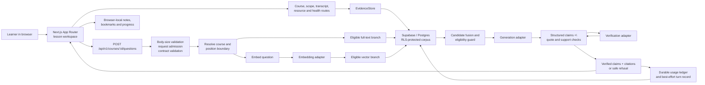

# Horizon architecture (PS1 MVP)

## Question path

`src/app/api/v1/courses/[courseId]/questions/route.ts` rejects declared oversize requests, admits the client through the rate limiter, reads a bounded body and validates the request contract before resolving the course. It clamps the requested playhead to the course duration and calls `answerQuestion` in `src/lib/answer/pipeline.ts`.

The pipeline creates a query embedding, searches lexical and vector evidence, applies the same time eligibility predicate to both branches, fuses results, checks payload eligibility again, requests structured claims, verifies citations against stored text and drops unsupported claims. It returns a cited answer only when claims pass; otherwise it returns a typed refusal or temporary-unavailability state. The route serializes the public response shape explicitly and records usage/turn metadata through the configured ledger/store.

## Data and privacy boundaries

- Supabase access is server-side. The connected project's learning tables have RLS enabled with no browser-facing policies; service-role access stays in server code.
- The answer request's playhead is learner-supplied and is not an authorization boundary. Position-aware behavior prevents accidental future leakage in the product flow; it does not prove watched time or user identity.
- Public health is a reduced projection. Detailed diagnostics require a bearer token.
- Notes, bookmarks and progress use browser storage; they are not account-synced.
- The synthetic fixture is a deterministic local path and must remain labelled as synthetic.

## Main implementation locations

- Learner UI: `src/components/learning-studio.tsx`, `src/components/lesson/`, `src/components/materials/`, `src/components/personal/`.
- API: `src/app/api/v1/`.
- Evidence and eligibility: `src/lib/retrieval/`, `src/lib/eligibility/`.
- Generation and verification: `src/lib/answer/`.
- Supabase schema: `supabase/migrations/`.
- Automated regression coverage: `tests/`.
